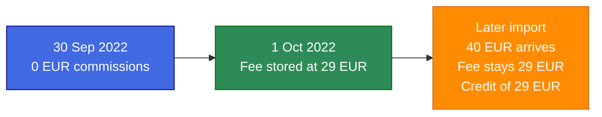

# Lagom — Merchant Settlement Engine

Lagom is a Swedish word for balance and the right measure. This app calculates merchant disbursements and seQura commissions from order data.

Built for the [seQura backend coding challenge](https://sequra.github.io/backend-challenge/).

## Setup and run

Ruby 4.0.7. Rails 8.1.4. PostgreSQL 16 on `localhost:5434`. MinIO on `localhost:9000` (bucket `lagom`) for uploaded CSVs.

```bash
docker compose up -d
bundle install
bin/rails db:prepare
bin/rails runner 'User.create!(email: "operator@lagom.local", password: "password123456")'
bin/dev
```

`bin/dev` starts the web process, the Tailwind watcher, and Solid Queue (`bin/jobs`). Sign in at [http://localhost:3000](http://localhost:3000) with that email and password. `db/seeds.rb` does not create a user.

If the AWS variables below are unset in development, they fall back to the local MinIO service:

- `AWS_ACCESS_KEY_ID=lagom`
- `AWS_SECRET_ACCESS_KEY=lagom-secret`
- `AWS_DEFAULT_REGION=us-east-1`
- `AWS_ENDPOINT_URL=http://localhost:9000`
- `AWS_S3_BUCKET_NAME=lagom`

`CSV_IMPORT_BATCH_SIZE` defaults to `500`.

### Official CSVs

The sample files are `;`-separated. From **CSV imports**, upload merchants first, then orders. A successful import stores rows and does not settle them.

To settle the historical file on the days the jobs would have run (instead of one disbursement per merchant today):

```bash
bin/rails lagom:replay_year YEAR=2023
```

Replay walks day by day from the oldest pending order through 7 January of the next year. Orders placed after 31 December of `YEAR` stay pending. Monthly fees close through December of `YEAR`. A later import of current orders does not need a replay; `DailyMerchantsJob` and `WeeklyMerchantsJob` settle what is already stored.

A row error rolls the whole file back. Nothing from that CSV is stored. The import page offers a plain-text download of line and column. An `id` that is already stored is one of those errors (`has already been processed and cannot be imported again`). The same `id` repeated only inside a file that has not been stored yet keeps the last row.

## Yearly report

The values below are the official merchants and orders CSVs, settled through 14 November 2023. No order in that file arrives after its month was closed, so no monthly-fee credit was recorded. Importing a CSV does not fill this table. After replay, open **Yearly report** or run:

```bash
bin/rails runner 'puts YearlyReportService.call.inspect'
```

| Year | Number of disbursements | Amount disbursed to merchants | Amount of order fees | Number of monthly fees charged | Amount of monthly fees charged |
| --- | ---: | ---: | ---: | ---: | ---: |
| 2022 | 1509 | 36,928,327.40 € | 334,670.02 € | 31 | 562.83 € |
| 2023 | 10391 | 188,559,107.94 € | 1,714,752.55 € | 104 | 1,735.65 € |

- **Year** of a disbursement is `disbursed_on`. An order placed on 31/12/2022 and disbursed on 01/01/2023 counts in 2023.
- **Year** of a monthly fee is the closed month. The December 2022 fee counts in 2022.
- **Amount disbursed to merchants** is net: order gross minus order commissions. Monthly fees are not subtracted.
- **Number of monthly fees charged** and **Amount of monthly fees charged** count rows with `charged_cents > 0` (the month was evaluated and a fee was stored). A stored `0.00 €` row is not counted.

## Domain rules

- Orders are disbursed exactly once (`orders.disbursement_id`). A second run for the same merchant and day does not insert another disbursement or another monthly fee for the same month.
- Each disbursement has a unique alphanumerical `reference` (`SecureRandom.hex(16)`). The disbursement show page lists the included orders, gross, order fees, and net.
- `DailyMerchantsJob` settles `DAILY` merchants. `WeeklyMerchantsJob` settles `WEEKLY` merchants. Both run at **07:00 UTC** every day so processing can finish before 08:00 UTC. A weekly merchant is paid only on the weekday of `live_on`.
- On an eligible day the job issues one disbursement containing every pending order with `ordered_on` from `live_on` through the day before. An order stored after that run waits for the next eligible day.
- Amounts with a digit after the second decimal place round up to the next cent before commission is calculated (`1.239` → `1.24 €`, `1.230` stays `1.23 €`).
- Commission is per order, rounded up to the next cent: below 50 € → 1.00%; 50 € inclusive up to but not including 300 € → 0.95%; 300 € or more → 0.85%.
- At the start of each month the previous calendar month is closed: if that month's order commissions are below `minimum_monthly_fee`, the difference is stored as a monthly fee. If they meet or exceed the minimum, the stored charge is `0.00 €`. Charging that fee to the merchant is out of scope; it is not subtracted from the disbursement. A month with no commissions is charged the full minimum. The first month is charged in full even when `live_on` falls mid-month. There is no pro-rata.

## Technical choices

- **Rails 8 + PostgreSQL + Solid Queue**, not a one-off script, so new orders can be imported and settled on a schedule.
- **Money as integer cents** (`Finance::Amount`). No `Float`. Commission bands live in `Commission`, not in the money helper.
- **Two recurring jobs**, not a backfill job. Import persists; jobs settle. Historical days that already passed are replayed with `lagom:replay_year`.
- **Pending orders through yesterday**, not a rigid calendar window. If a day is skipped, those orders go into the next eligible disbursement instead of leaving a hole.
- **`exactly once` is a foreign key**, not a join table, so an order cannot sit on two disbursements.
- **UTC** (`config.time_zone = "UTC"`). Screen dates are `DD/MM/YYYY`. Amounts group thousands with a dot decimal (`36,928,327.40 €`).
- **English UI** through Rails I18n from day one. The operator console (Hotwire, Tailwind, ViewComponents) is for reporting: merchants, disbursements, monthly fees, yearly report, CSV imports. Lists paginate at 10 rows. Mission Control is at `/jobs` (signed-in operator only; not linked in the sidebar).
- **Devise** email/password only. One operator. No public signup, recovery, confirmation, or lock.
- **CSV in an object store** before the import record is created. One worker process, one thread (`config/queue.yml`).

Planning notes: [docs/planning.md](docs/planning.md).

## Assumptions

The challenge text does not decide these points. The code does.

1. **50 € / 300 € bands.** “Between 50 € and 300 €” and “300 € or more” overlap at 300 €. 50.00 € uses 0.95%. 300.00 € uses 0.85%.
2. **Cutoff at 07:00 UTC.** Orders with `ordered_on` equal to the run date are excluded. They wait for the next eligible day.
3. **Year axis.** Disbursements follow `disbursed_on`. Monthly fees follow the closed month.
4. **No pro-rata** on the live-on month or on a month with no commissions.
5. **Orders after a closed month.** The challenge does not say what to do. A stored monthly fee is not rewritten. The job records a `MonthlyFeeAdjustment`: the new commission total and a credit up to what was charged. The yearly table keeps the amount originally assessed. Credits are listed under **Adjustments** (year the credit was recorded, reference year of the fee). The table does not replace 100 € with 60 €, and it does not report 140 €.

Example: minimum 29 €. September closed at 0 € commissions, so 1 October stores 29 €. A later import adds 40 € of September commission. The fee row stays 29 €. The adjustment is 40 € of commissions and a 29 € credit.



If jobs did not run for years, one eligible day pays every pending order through yesterday in a single disbursement, and then closes every elapsed month that still has no fee. October of the run stays open.

## Decisions not taken

- No manual order form. New orders arrive through CSV.
- No CORS. There is no separate frontend origin.
- Monthly fees are stored, not invoiced or deducted from net.
- The seed does not create an operator and does not import the official CSVs.

## Trade-offs

- An operator console, Devise, and object storage are more than a CLI that prints the table. The extra surface is for reporting and for importing future orders without another deploy.
- Late-order adjustments are extra relative to the brief. Leaving a closed month mutable would have been smaller; it would also rewrite a figure already used for reporting.
- One Solid Queue thread avoids concurrent settlement of the same merchant. Large imports wait behind settlement.
- Railway Hobby is enough to host a staging/production pair. It is not sized for the full 1.3 million-row file as live traffic.

## What I would improve with more time

- **P0.** No logging service (for example Datadog). Server logs are the workaround today.
- **P1.** Measure how the current infra behaves under the official file size and under concurrent imports.

## Questions for seQura

- Year axis: should a disbursement on 01/01/2023 of a 31/12/2022 order count in 2023, and the December fee in 2022? That is what this report does.
- Pro-rata: the first month is charged the full minimum when `live_on` is mid-month, and a month with no commissions is charged the full minimum. Should either case be prorated?

## AI usage

Cursor was used to plan and implement. Business rules come from the challenge text and from the decisions recorded in planning, not from behaviour invented to fill gaps.

Prompt log (Portuguese, original wording): [day 1](docs/registro-da-construcao.md), [day 2](docs/registro-da-construcao-dia-2.md), [day 3](docs/registro-da-construcao-dia-3.md), [day 4](docs/registro-da-construcao-dia-4.md).

## Tests

```bash
bundle exec rspec
COVERAGE=true bundle exec rspec
bundle exec rubocop
bundle exec bundler-audit check --update
bundle exec brakeman -q -w2
```

RSpec runs in random order with the documentation formatter. SimpleCov in CI fails below 95% line coverage.

## CI and deploy

GitHub Actions on every pull request and on push to `main` / `staging`: RSpec, RuboCop, `bundler-audit` + Brakeman, coverage.

Railway: `staging` → staging, `main` → production. A pull request does not deploy. Attach Postgres and set `RAILS_ENV`, `DATABASE_URL`, `SECRET_KEY_BASE`, `APP_HOST`, and the `AWS_*` variables above. Web + worker come from the `Procfile`. Pre-deploy and the production container run `db:prepare`. Neither creates an operator.
