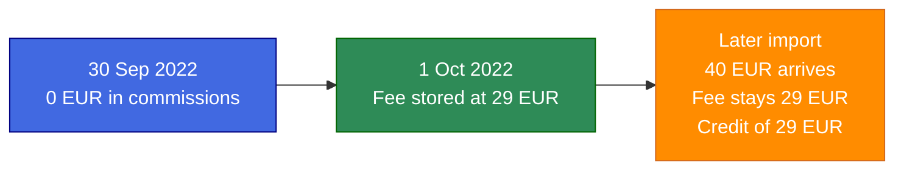
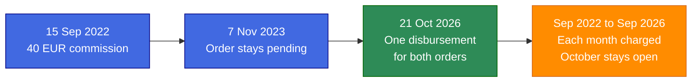
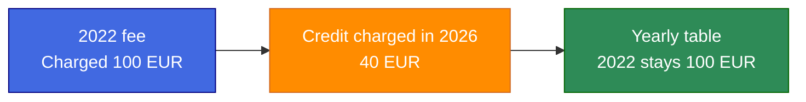
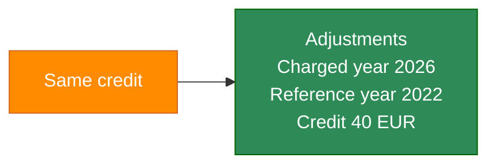

# Lagom — Merchant Settlement Engine

Lagom is a Swedish word for balance and the right measure. This app calculates fair merchant disbursements and seQura commissions from order data.

Built for the [seQura backend coding challenge](https://sequra.github.io/backend-challenge/).

## Disclaimer


> [!CAUTION]
> **A processed month is immutable.**
>
> An important edge case: orders that arrive after a month has been closed cannot change that closed month. They must enter as an adjustment. This guarantees auditing, public policies, and similar requirements.
>
> Because of this, a few details of the flow and of the reports for these edge cases differ from the flow in the original challenge statement.

### Order arrives after the month is closed

The minimum is €29. September ends with no commissions, so the fee stored on 1 Oct is €29. A later import adds €40 of commission to that same September. The fee row stays €29. The difference is an adjustment: €40 of commissions, and a credit of €29, the amount that was charged.



### October 2026 run for a merchant live since September 2022

The run issues one disbursement dated 21 Oct 2026 for the stored orders, and a fee for every month from September 2022 through September 2026. October 2026 stays open. September 2022 earned €40, which is above the €29 minimum, so that month is charged €0. September 2026 earned nothing, so it is charged €29. The 2022 commissions do not change the 2026 fee. The yearly report counts that disbursement in 2026.



### Yearly report when a €100 fee receives a €40 credit

The amount originally assessed is the €100 stored when the month closed. The amount after the adjustment is €60: €100 minus the €40 credit. The yearly table keeps the €100. It does not replace it with €60, and it does not report €140. The €40 is the difference between those two amounts. It is listed under Adjustments, with charged year 2026 and reference year 2022. Why the two amounts stay apart is set out under [Yearly report](#yearly-report).





Planning: [docs/planning.md](docs/planning.md).

How the AI was used: [day 1](docs/registro-da-construcao.md), [day 2](docs/registro-da-construcao-dia-2.md), [day 3](docs/registro-da-construcao-dia-3.md), [day 4](docs/registro-da-construcao-dia-4.md). Those records stay in Portuguese. Translating them would replace the original wording of the prompts, and that wording is what the audit has to preserve.

## Stack

- Ruby 4.0.7
- Rails 8.1.4
- PostgreSQL
- Solid Queue (1 process, 1 thread)
- Solid Cable (messages in the primary database)
- Hotwire + Tailwind (Railway-inspired dark UI)
- Pagy (10 rows per page)
- RSpec, FactoryBot, SimpleCov
- Devise (email and password only)
- Mission Control at `/jobs` (not linked from the sidebar)

## Setup

```bash
docker compose up -d
bundle install
bin/rails db:prepare
bin/dev
```

In another terminal:

```bash
bin/jobs
```

The seed does not create a user. Create the operator outside `db/seeds.rb`.

Postgres defaults to `localhost:5434` so it does not collide with other local databases.

`docker compose up -d` also starts a local S3-compatible bucket (MinIO) on `localhost:9000` and creates a bucket named `lagom`. In development, these variables fall back to that local bucket when they are unset:

- `AWS_ACCESS_KEY_ID=lagom`
- `AWS_SECRET_ACCESS_KEY=lagom-secret`
- `AWS_DEFAULT_REGION=us-east-1`
- `AWS_ENDPOINT_URL=http://localhost:9000`
- `AWS_S3_BUCKET_NAME=lagom`

`CSV_IMPORT_BATCH_SIZE` defaults to `500`.

## CSV import

From **CSV imports**, choose Merchant or Orders and upload one `;`-separated CSV. The file is stored in the bucket as `{kind}-{timestamp}.csv` before the import record is created. The request returns immediately with status `processing`. Solid Queue reads the file in batches. A successful import stores the rows and does not settle them. `DailyMerchantsJob` and `WeeklyMerchantsJob` settle what is already stored.

Orders from past years that were paid on time are imported through the same form. The jobs would otherwise settle them today, in one disbursement per merchant. To settle them on the days the jobs would have run, replay the year after the import succeeds:

```bash
bin/rails lagom:replay_year YEAR=2023
```

The replay walks day by day from the oldest pending order through 7 January of the next year. Orders placed after 31 December of `YEAR` stay pending. Monthly fees close through December of `YEAR`. A 2022 order and a 2023 order in the same file, replayed with `YEAR=2023`, are each disbursed on the day the job would have run. A later 2026 import does not need a replay; the scheduled jobs settle it.

A row error rolls the whole file back. Nothing from that CSV is stored, and no settlement job is enqueued. The import page offers a plain-text download of the line and column. An `id` that is already stored is one of those errors. The download reads `line 2, column id: has already been processed and cannot be imported again`. The same `id` repeated only inside a file that has not been stored yet keeps the last row.

The show page subscribes over Action Cable while the import is `pending` or `processing`. When the status changes, the page replaces the status block in place. A finished import does not subscribe. Solid Cable carries the message from the worker process to the web process.

## Operator console

The sidebar lists merchants, disbursements, monthly fees, the yearly report, and CSV imports.

Each index shows 10 rows per page. The footer reads `Showing 1–10 of 12 · 10 per page`, including when the list fits on one page. Filters update as you type: a partial, case-insensitive match on name or email, a calendar for dates, and a dropdown for tags such as frequency or status. There is no Filter button. Each column header has ↑ and ↓. Dates render as `DD/MM/YYYY`. Amounts group thousands and keep a dot decimal, as in `36,928,327.40 €`.

## Settlement rules implemented

- Orders are disbursed exactly once. Running a job again for a day that already has a disbursement does not insert another one, and does not insert a second monthly fee for the same merchant and month.
- `DailyMerchantsJob` settles `DAILY` merchants. `WeeklyMerchantsJob` settles `WEEKLY` merchants. Both run at 07:00 UTC every day. The weekly job runs every day because each merchant is paid on the weekday of their own `live_on`. On any other weekday that merchant gets no disbursement.
- `disbursed_on` is the day the disbursement is issued. On an eligible day the job issues one disbursement for that merchant, containing every pending order with `ordered_on` from `live_on` through the day before. A daily merchant is eligible every day. A weekly merchant is eligible only on the weekday of `live_on`. A second run that day does not insert another disbursement, and an order stored after it waits for the next eligible day. The order date stays on the order.
- An amount with a digit after the second decimal place rounds up to the next cent before commission is calculated. `1.239` becomes `1.24 €`. `1.230` stays `1.23 €`.
- Commission is calculated per order and rounded up to the next cent: `< 50€` → 1.00%, `50€..<300€` → 0.95%, `≥ 300€` → 0.85%.
- Net to merchant = gross − order commissions. Monthly fees are stored, not subtracted.
- Each job closes every month from that merchant's `live_on` month through the previous calendar month when the fee does not exist yet. It does not close the current month. `ChargeMonthlyFeeService` does not create a second row for the same merchant and month. Each month is charged from its own commissions.
- A charged month is not rewritten. When a later import adds orders to a month that already has a fee, the job keeps that fee row as it was and stores a `MonthlyFeeAdjustment` with the new commission total and the credit owed back: the part of the charge those commissions now cover. More late orders add another adjustment for the further difference only. A credit never exceeds what was charged. The yearly table shows the fees charged for months in that year and does not subtract credits. The adjustments table lists each credit with the year it was charged and the reference year of the fee.
- A month with no commissions is charged the full minimum. The first month is charged in full even when `live_on` falls in the middle of it. There is no pro-rata.

## Yearly report

A disbursement counts in the year of `disbursed_on`. A monthly fee counts in the year of the closed month, which is the `year` stored on the fee. An order placed on 31/12/2022 and disbursed on 01/01/2023 counts in 2023. The December 2022 fee counts in 2022.

The page filters by year as you type, sorts every column, and pages 10 years at a time. It stays subscribed over Action Cable. A new or changed disbursement or monthly fee refreshes the table, at most once every 2 seconds, and each settlement job sends one more refresh when it finishes. The current year filter, sort, and page stay in the URL.

### Assessed amount and amount after adjustments

**Amount of monthly fees** is the amount originally assessed: the sum of what was charged when each month of that year closed. That is the challenge column "Amount of monthly fees charged". The rows below are that figure for the official file settled through 14 Nov 2023. No order in that file arrives after its month was closed, so nothing was credited. For those two years the assessed amount and the amount after adjustments are the same.

A later order cannot change a closed month. The fee stays at the amount that was charged. The job records a credit for the part of that charge the new commissions cover. Take a fee assessed at €100 that later receives a €40 credit:

- **Originally assessed:** €100. The yearly table keeps this in the year of the fee.
- **After adjustments:** €60, which is €100 minus the €40 credit.
- **The difference** is the €40 credit. It is listed under Adjustments, with the year the credit was recorded and the reference year of the fee.

The table does not replace €100 with €60, and it does not report €140. €60 is what remains after the credit. Writing it into the closed year would erase the amount that was actually charged. €140 is neither the amount charged nor the amount that remains. The challenge does not say what to do with an order that arrives after the month is closed. The requested column stays a record of what was charged, so a closed month can still be audited. The credit stays beside it, and the two amounts can be reconciled without rewriting the month.

The table is the official file as settled through 14 Nov 2023. Importing a CSV does not settle it, and the jobs do not rebuild this table. Open **Yearly report** or run:

```bash
bin/rails runner 'puts YearlyReportService.call.inspect'
```

| Year | Number of disbursements | Amount disbursed to merchants | Amount of order fees | Number of monthly fees charged | Amount of monthly fees |
| --- | ---: | ---: | ---: | ---: | ---: |
| 2022 | 1509 | 36,928,327.40 € | 334,670.02 € | 31 | 562.83 € |
| 2023 | 10391 | 188,559,107.94 € | 1,714,752.55 € | 104 | 1,735.65 € |

## Tests

```bash
bundle exec rspec
COVERAGE=true bundle exec rspec
bundle exec rubocop
bundle exec bundler-audit check --update
bundle exec brakeman -q -w2
```

RSpec runs in random order with the documentation formatter.

## CI/CD

GitHub Actions runs four parallel jobs on every pull request and push:

1. RSpec
2. RuboCop
3. Vulnerability (`bundler-audit` + `brakeman`)
4. Coverage (SimpleCov, minimum 95%)

Deploy waits for all four. Configure Railway to deploy `staging` → staging and `main` → production.

## Railway

Create two environments (staging, production), attach Postgres, set:

- `RAILS_ENV`
- `DATABASE_URL`
- `SECRET_KEY_BASE`
- `APP_HOST`
- `AWS_ACCESS_KEY_ID`
- `AWS_SECRET_ACCESS_KEY`
- `AWS_DEFAULT_REGION`
- `AWS_ENDPOINT_URL`
- `AWS_S3_BUCKET_NAME`

`CSV_IMPORT_BATCH_SIZE` is optional and defaults to 500.

Run web + worker processes from the `Procfile`. The Railway pre-deploy command and the production container both run `db:prepare` before the server starts. Neither creates an operator.

## What I would improve with more time

- **P0.** No logging service such as Datadog. Server logs are the workaround today.
- **P1.** Railway Hobby will not absorb large data or user load. Measure infra behaviour next.

## Questions for seQura

- Year axis: should a disbursement on 01/01/2023 of a 31/12/2022 order count in 2023, and the December fee in 2022? That is what this report does.
- Pro-rata: the first month is charged the full minimum when `live_on` is mid-month, and a month with no commissions is charged the full minimum. Should either case be prorated?
## Decisions and AI usage

- Money is stored as integer cents via `Finance::Amount`. The screen groups thousands (`131,931.34 €`). Product commission tiers live in `Commission`.
- Dates on screen use `DD/MM/YYYY`. Filter fields still submit `YYYY-MM-DD`, which is what the date input requires.
- UI strings go through Rails I18n (`en`) from day one.
- Tailwind ViewComponents mirror the railway.com dark palette without copying Railway branding.
- Cursor was used to plan and implement. Business rules come from the challenge text and the decisions recorded during planning, not from invented product behaviour.

## What was left out on purpose

- No manual order form; new orders arrive through CSV.
- No CORS setup; there is no separate frontend origin.
- No public signup, password recovery, confirmation, or account lock. One operator account owns the console.
