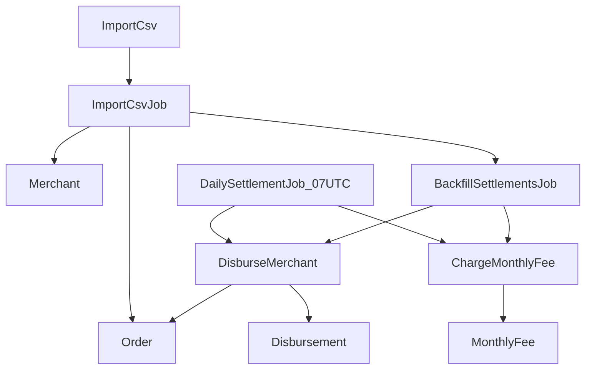

This is the V0 planning document for Lagom.

# Lagom — Merchant Settlement Engine

App novo em `[/home/rpissardo/lagom](/home/rpissardo/lagom)`, fora de `international-companies-frontend`. Repositório GitHub **privado** na conta pessoal (`gh repo create lagom --private`). Se a conta do `gh` não for a pessoal, paro antes de criar.

Stack: **Ruby 4.0.7** (estável; 4.1.0 ainda é preview) e **Rails 8.1.4**. Se o `rails new` não subir em Ruby 4.0, paro e aviso — não troco silencioso para 3.4. Postgres. Solid Queue em development, staging e production. Teste usa o adapter do ActiveJob para o spec ficar rápido e afirmar `have_enqueued_job`.

## O que o texto fecha

Fonte: [seQura backend challenge](https://sequra.github.io/backend-challenge/) e os CSV oficiais (`merchants.csv`, `orders.csv`, separador `;`).

- 50 merchants (`live_on` de 2022-09-04 a 2023-02-01; 36 DAILY, 14 WEEKLY) e 1.309.023 orders (`created_at` de 2022-09-04 a 2023-11-07).
- Commission por pedido: abaixo de 50 € = 1%; de 50 € inclusive até abaixo de 300 € = 0,95%; 300 € ou mais = 0,85%.
- Arredondar **para cima** a 2 casas em cada commission.
- Líquido do merchant = bruto dos pedidos − commissions. Monthly fee não entra nesse líquido.
- Monthly fee no início do mês seguinte: se a soma das commissions do mês civil anterior for menor que `minimum_monthly_fee`, guardar a diferença. Sem pró-rata. Mês sem commission, dentro do intervalo fechado abaixo, cobra o mínimo cheio.
- Job diário **concluído até** 08:00 UTC. Por isso o recurring do Solid Queue dispara às **07:00 UTC**, não às 08:00.
- Pedido anterior a `live_on` é linha inválida. Pedido com `ordered_on >= live_on` entra.
- Sem pedidos na janela, não cria disbursement.

## Três ajustes em cima da leitura combinada

- **Relógio do backfill.** O CSV acaba em 2023-11-07. Se o cron usar “hoje” (2026-10-16), o catch-up de mês zerado criaria mínimos de 2024 até 2026 e dominaria o relatório. O import não usa essa data. Disbursement e monthly fee têm relógios diferentes. O pedido de 2023-11-07 só fica elegível na manhã seguinte (diário) ou no próximo weekday de `live_on` (semanal, no máximo 7 dias depois). O backfill de disbursement simula cada dia de `live_on` até 2023-11-14. Sem pedido na janela, não cria disbursement. Monthly fee só fecha mês cujo dia 1 do mês seguinte já passou nesse mundo: por merchant, do mês de `live_on` até outubro/2023. Novembro/2023 tem pedidos e não tem monthly fee, porque 2023-12-01 não chega, e o cron ao vivo não volta para cobrá-lo. O cron ao vivo, depois do deploy, fecha só o dia devido e o mês anterior imediato. Não varre os anos em que o sistema não existia. Se o app seguir no ar, o primeiro monthly fee ao vivo sai em 2026-11-01, referente a outubro/2026, no mínimo cheio.
- **Janela rígida perde pedido.** A janela normal do diário é `ordered_on = ontem`. A do semanal, no weekday de `live_on`, é `D-7..D-1`. A query de produção pega **não disbursed** com `ordered_on <= ontem` e `ordered_on >= live_on`, e o semanal só roda no weekday certo. Com o job em dia, o conjunto é a janela. Se um dia falhar, o próximo run alcança o atraso. Isso é o que torna verdadeiro o “exactly once”.
- **Sem notificação em GET.** Toda ação que altera estado (POST/PATCH/DELETE), toda falha e todo aceite assíncrono devolvem flash positiva ou negativa. GET de leitura ok não mostra toast. O fim do job atualiza a tela do import por Turbo Stream.

Não há formulário manual de pedido. Pedido novo entra por outro CSV; o job diário disbursa o que já está gravado.

## Dinheiro

Módulo `Finance::Amount`, em centavos, com `Integer` (precisão arbitrária do Ruby). Cabe em outro fluxo depois: centavos, teto a 2 casas e formatação em euro. Não uso a gem Money: a regra é teto, não o arredondamento padrão da gem, e só existe EUR. A faixa de 1% / 0,95% / 0,85% fica em `Commission`, que chama `Finance::Amount`. Essa faixa é regra deste produto, não do módulo de dinheiro.

`0,95%` de 61,74 €: `(6174 * 95).ceildiv(10_000) = 59` centavos = 0,59 €. Sem `Float`.

Colunas `*_cents` integer, `null: false`, check `>= 0`. A commission do pedido é calculada uma vez na importação e persistida. O disbursement soma esses centavos.

## Modelo

Não há N×N no domínio. “Exactly once” é `orders.disbursement_id`, não tabela de junção. Junção permitiria o mesmo pedido em dois disbursements.

- `merchants` — `id` uuid vindo do CSV. `reference` único, `email`, `live_on` date, `disbursement_frequency` (`DAILY`/`WEEKLY`), `minimum_monthly_fee_cents`.
- `orders` — `id` uuid gerado. O id do CSV (12 hex no sample, não é uuid) fica em `external_id` único. `merchant_id`, `ordered_on` date, `amount_cents`, `commission_cents`, `disbursement_id` nulo até pagar. A coluna `created_at` do CSV entra em `ordered_on`. `t.timestamps` segue com `created_at` / `updated_at` para a linha no banco.
- `disbursements` — uuid, `merchant_id`, `disbursed_on`, `reference` único (`{reference}{YYYYMMDD}`, só letras, números e o underscore que o reference do merchant já tem), `gross_cents`, `commission_cents`, `net_cents`. Único `(merchant_id, disbursed_on)`.
- `monthly_fees` — uuid, `merchant_id`, `year`, `month`, `commissions_cents`, `charged_cents`. Único `(merchant_id, year, month)`. Linha com `charged_cents = 0` significa “mês avaliado, nada cobrado” e segura a idempotência. O relatório conta só `charged_cents > 0`.
- `users` — operador, model `User` com Devise (`database_authenticatable` e `validatable`). Sem cadastro público, sem recuperação de senha, sem confirmação e sem bloqueio.
- `csv_imports` — status do job (`pending`, `processing`, `succeeded`, `failed`), contadores, erros limitados.

FKs `on_delete: :restrict`. Datas de negócio em UTC (`config.time_zone = "UTC"`).

Indexes, alinhados às validações e às buscas:

- únicos: `merchants.reference`, `orders.external_id`, `disbursements.reference`, `(disbursements.merchant_id, disbursed_on)`, `(monthly_fees.merchant_id, year, month)`, `users.email`
- job: `(orders.merchant_id, ordered_on) WHERE disbursement_id IS NULL`
- listas: `orders (merchant_id, ordered_on)`, `disbursements.disbursed_on`, `monthly_fees.year`, `merchants.disbursement_frequency`
- checks: frequency em `DAILY`/`WEEKLY`, centavos `>= 0`, presença via `null: false`

Amount zero passa. Amount negativo, campo ausente, merchant desconhecido ou pedido antes de `live_on` é erro da linha. Um erro de linha desfaz o arquivo inteiro. Nada desse CSV entra.

## Telas

Tailwind e Hotwire. A paleta sai do CSS público de [railway.com](https://railway.com/): fundo `#08070C`, superfície `#13111C`, texto `#F0EAF2`, acento `#A898F0`, roxos de apoio `#2C0A5C` e `#16093B`, borda branca a cerca de 8% de opacidade. Fonte de interface Inter. Números e valores em euro com JetBrains Mono. Tema escuro único. Sem logo nem ilustração da Railway.

As telas não estilizam elemento solto. Tudo passa por um kit pequeno de ViewComponents:

- `AppShell` — barra lateral e topo
- `PageHeader`
- `Button` — primary, secondary, danger
- `Card`
- `Badge` — frequência, status do import, fee cobrada ou zero
- `DataTable`
- `Stat` — números do relatório anual
- `EmptyState`
- `Flash` — `role="status"` ou `role="alert"`
- `Field` — label, input e erro
- `Money` — centavos formatados em euro

Inglês desde o início, via I18n do Rails. `config.i18n.default_locale` e `available_locales` ficam em `:en`. Texto de tela, flash, validação, botão e estado vazio saem de `config/locales/en.yml` com `I18n.t`. ViewComponent também. Sem string fixa na view. O README segue em inglês.

Autenticado, um operador, vê todos os merchants (o enunciado não tem papel por merchant):

- Merchants: lista e detalhe
- Orders do merchant, paginados, com commission
- Disbursements: lista e detalhe (pedidos, bruto, commission, líquido)
- Monthly fees
- Relatório anual com as colunas do desafio
- Import de CSV: o POST responde na hora com notice de processamento; a show acompanha o status e o Turbo Stream troca para sucesso ou falha
- Mission Control (`mission_control-jobs`) montado em `/jobs`, para ver fila, recurring e falhas do Solid Queue. O engine herda um controller que exige a sessão do operador. O HTTP basic da gem fica desligado, para não criar uma segunda senha. A UI interna da gem permanece a dela. O shell em volta usa `AppShell`.

Estados vazios usam `EmptyState`. Erro de validação usa `Field`. Flash usa `Flash`.

Relatório anual lê `disbursements` e `monthly_fees` (milhares de linhas), síncrono. Import e backfill passam de 0,5 s: Solid Queue, resposta imediata.

## Segurança

- SQL: ActiveRecord e binds. Sem interpolar parâmetro em SQL.
- XSS: escape padrão, sem `html_safe` / `raw`.
- CSRF: `protect_from_forgery` do Rails.
- Sessão do Devise no cookie do Rails, httponly, `same_site: :lax`, `force_ssl` em staging e production.
- CORS: não instalo. Não há outro origin.
- Rate limit com `rack-attack`: login e POST de import.
- SSRF: o upload é arquivo, nunca URL vinda do usuário. O CSV oficial entra por host fixo `sequra.github.io`, escrito no código. Sem HTTP para destino informado no form.
- Senha com Devise, só login. O seed não cria usuário.
- `/jobs` só abre com o operador logado. Sem isso o painel de fila ficaria público.

## Ambientes e Railway

- **test** e **development**: locais. `docker-compose.yml` só com Postgres.
- **staging** e **production**: Railway, dois environments, dois Postgres, `RAILS_ENV` próprio (`config/environments/staging.rb` parte de production).
- Processos: web (Puma) e um worker (`bin/jobs`). Em `config/queue.yml`, development, staging e production ficam com 1 processo e 1 thread. Só um job executa por vez. O supervisor do Solid Queue continua, porque sem ele não há worker nem recurring. Volume compartilhado para o CSV enviado, porque disco de container não é compartilhado e o arquivo tem dezenas de MB.
- Release: `bin/rails db:prepare`. Não cria operador e não reimporta o CSV.
- Recurring em `config/recurring.yml`: 07:00 UTC.

## CI/CD

GitHub Actions em `.github/workflows/ci.yml`. Em pull request e em push, quatro jobs sem `needs` entre eles:

- **rspec** — `bundle exec rspec`, Postgres de serviço, ordem aleatória, formato documentation.
- **rubocop** — `rubocop-rails-omakase`, o conjunto que o Rails 8 já traz.
- **vulnerability** — `bundler-audit` contra o advisory de gems e `brakeman` no código. Qualquer achado falha o job.
- **coverage** — a mesma suíte com SimpleCov. Falha abaixo de 95% de cobertura de linha. Roda em paralelo com o job de rspec, então a suíte executa duas vezes.

O deploy espera os quatro. Branch `staging` publica o environment staging do Railway. Branch `main` publica production. Pull request não faz deploy.

## Testes

RSpec e FactoryBot. `config.order = :random` em `spec/spec_helper.rb`. `.rspec` com `--format documentation`, `--require spec_helper` e `--color`, para o output listar cada exemplo pelo nome, inclusive no CI. Sem Faker em valor monetário.

TDD nos cálculos, antes da implementação:

- faixas e teto, inclusive 50 € e 300 €
- janela diária, semanal, primeiro ciclo depois de `live_on`, catch-up de dia perdido
- exactly once e repetir o job não duplica
- monthly fee: abaixo, igual, acima, mês zerado, mês parcial sem pró-rata, novembro/2023 fora do relógio do arquivo
- linha inválida não derruba o arquivo

System spec só no crítico, com CSV pequeno: login, import que mostra “processing” e termina em sucesso ou falha, relatório anual com os números da fixture. O CSV de 1,3 milhão não entra em spec.

## README

Título `Lagom — Merchant Settlement Engine`. Significado de lagom (equilíbrio, medida certa, origem sueca, cálculo justo). Setup, decisões, premissas, o que não foi feito (sem form de pedido, sem CORS, UI em inglês via I18n), tabela anual preenchida depois de rodar o import local no relógio do arquivo, e como a IA entrou (Cursor para planejar e implementar; regras de negócio só as escritas no desafio e as confirmadas aqui).

Tradeoffs da próxima versão, nesta ordem:

- **P0.** Não há serviço de log, como Datadog. Hoje o contorno são os logs do servidor.
- **P1.** O Railway está no plano Hobby. Não deve aguentar grande carga de dados ou de usuários. A próxima versão avalia como a infra se comporta.
- **P2.** Os CSVs não vão para um bucket. Depois do processamento, o arquivo deixa de ser rastreável.