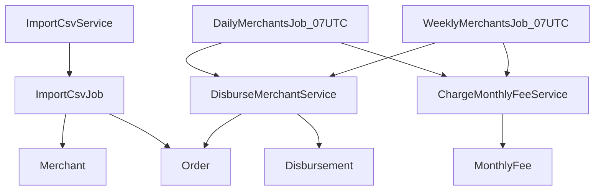

This is the V0 planning document for Lagom.

# Lagom — Merchant Settlement Engine

New app in `[/home/rpissardo/lagom](/home/rpissardo/lagom)`, outside `international-companies-frontend`. Private GitHub repository on the personal account (`gh repo create lagom --private`). If the `gh` account is not the personal one, stop before creating it.

Stack: **Ruby 4.0.7** (stable; 4.1.0 is still a preview) and **Rails 8.1.4**. If `rails new` does not boot on Ruby 4.0, stop and say so. Do not silently fall back to 3.4. Postgres. Solid Queue in development, staging, and production. Test uses the Active Job test adapter so specs stay fast and can assert `have_enqueued_job`.

## What the brief decides

Source: [seQura backend challenge](https://sequra.github.io/backend-challenge/) and the official CSVs (`merchants.csv`, `orders.csv`, separator `;`).

- 50 merchants (`live_on` from 2022-09-04 to 2023-02-01; 36 DAILY, 14 WEEKLY) and 1,309,023 orders (`created_at` from 2022-09-04 to 2023-11-07).
- Commission per order: below 50 € = 1%; from 50 € inclusive up to but not including 300 € = 0.95%; 300 € or more = 0.85%.
- Round **up** to 2 decimal places on every commission. An amount with a digit after the second decimal place also rounds up to the next cent before that commission is calculated: `1.239` becomes 124 cents, `1.230` stays 123 cents.
- Merchant net = order gross − commissions. The monthly fee is not part of that net.
- Monthly fee at the start of the next month: if the previous calendar month's commissions are below `minimum_monthly_fee`, store the difference. No pro-rata. A month with no commission is charged the full minimum. The first month is charged in full even when `live_on` falls in the middle of it.
- The daily job must **finish by** 08:00 UTC. Solid Queue recurring therefore fires at **07:00 UTC**, not at 08:00.
- An order before `live_on` is an invalid row. An order with `ordered_on >= live_on` is accepted.
- No orders in the window means no disbursement.

## Three adjustments on top of that reading

- **Two jobs, no backfill.** `DailyMerchantsJob` settles `DAILY` merchants. `WeeklyMerchantsJob` settles `WEEKLY` merchants. Both fire at 07:00 UTC every day, because each weekly merchant is paid on the weekday of their own `live_on`. Import stores rows and does not settle them. The first run for a merchant starts at `live_on`. A later run starts the day after that merchant's latest disbursement and pays every eligible day up to the calendar day, one disbursement per day. Running the same day again does not insert another disbursement or another monthly fee. Each job closes only the immediately previous month, and only for its own merchants. It does not close older months.
- **A rigid window drops orders.** The normal daily window is `ordered_on = yesterday`. The weekly window, on the `live_on` weekday, is `D-7..D-1`. The production query takes **undisbursed** orders with `ordered_on <= yesterday` and `ordered_on >= live_on`, and the weekly merchant runs only on the right weekday. When the job is on time, that set is the window. If a day fails, the next run catches up. That is what makes "exactly once" true.
- **No notification on GET.** Every state-changing action (POST/PATCH/DELETE), every failure, and every async acceptance returns a positive or negative flash. A successful read GET shows no toast. When the import job finishes, a Turbo Stream updates the import screen. When a settlement job finishes, the yearly report refreshes.

There is no manual order form. A new order arrives through another CSV. The two jobs disburse what is already stored.

## Money

`Finance::Amount`, in cents, using `Integer` (Ruby's arbitrary precision). It can be reused later: cents, a ceiling at 2 decimal places, and euro formatting. A stored amount with a remainder after two decimal places rounds up to the next cent (`1.239` → 124). A remainder of zeros does not (`1.230` → 123). The Money gem is not used. The rule is a ceiling, not the gem's default rounding, and the only currency is EUR. The 1% / 0.95% / 0.85% bands live in `Commission`, which calls `Finance::Amount`. Those bands are a rule of this product, not of the money module.

`0.95%` of 61.74 €: `(6174 * 95).ceildiv(10_000) = 59` cents = 0.59 €. No `Float`.

`*_cents` columns are integers, `null: false`, check `>= 0`. An order's commission is calculated once at import and stored. A disbursement sums those cents.

## Model

There is no N×N in the domain. "Exactly once" is `orders.disbursement_id`, not a join table. A join would allow the same order on two disbursements.

- `merchants` — `id` is the UUID from the CSV. Unique `reference`, `email`, `live_on` date, `disbursement_frequency` (`DAILY`/`WEEKLY`), `minimum_monthly_fee_cents`.
- `orders` — generated UUID `id`. The CSV id (12 hex characters in the sample, not a UUID) is stored in a unique `external_id`. `merchant_id`, `ordered_on` date, `amount_cents`, `commission_cents`, `disbursement_id` null until paid. The CSV `created_at` column becomes `ordered_on`. `t.timestamps` still keeps `created_at` / `updated_at` for the database row.
- `disbursements` — uuid, `merchant_id`, `disbursed_on`, unique `reference` (`{reference}{YYYYMMDD}`, letters, digits, and the underscore the merchant reference already has), `gross_cents`, `commission_cents`, `net_cents`. Unique `(merchant_id, disbursed_on)`.
- `monthly_fees` — uuid, `merchant_id`, `year`, `month`, `commissions_cents`, `charged_cents`. Unique `(merchant_id, year, month)`. A row with `charged_cents = 0` means "month evaluated, nothing charged" and keeps the operation idempotent. The report counts only `charged_cents > 0`. The row is never rewritten after it is stored.
- `monthly_fee_adjustments` — uuid, `monthly_fee_id`, `commissions_cents`, `credit_cents`. Unique `(monthly_fee_id, commissions_cents)`. Written by the jobs when a later import raises the commissions of a month that already has a fee: `commissions_cents` is the new month total, `credit_cents` is the part of the original charge that total now covers, net of earlier adjustments. A row with `credit_cents = 0` means "re-evaluated, nothing more to return". The yearly report sums `credit_cents` by the year of `created_at`, the month the adjustment was recorded. Total monthly fees for a year are that year's `charged_cents` plus the credits recorded in that year. A `carried` adjustment belongs to the next fee the job charges and records commissions from months that have no fee of their own.
- `users` — the operator, a Devise `User` (`database_authenticatable` and `validatable`). No public signup, no password recovery, no confirmation, and no lock.
- `csv_imports` — job status (`pending`, `processing`, `succeeded`, `failed`), counters, bounded errors.

Foreign keys use `on_delete: :restrict`. Business dates are UTC (`config.time_zone = "UTC"`).

Indexes, aligned with validations and lookups:

- unique: `merchants.reference`, `orders.external_id`, `disbursements.reference`, `(disbursements.merchant_id, disbursed_on)`, `(monthly_fees.merchant_id, year, month)`, `(monthly_fee_adjustments.monthly_fee_id, commissions_cents)`, `users.email`
- job: `(orders.merchant_id, ordered_on) WHERE disbursement_id IS NULL`
- lists: `orders (merchant_id, ordered_on)`, `disbursements.disbursed_on`, `monthly_fees.year`, `merchants.disbursement_frequency`
- checks: frequency in `DAILY`/`WEEKLY`, cents `>= 0`, presence via `null: false`

A zero amount is accepted. A negative amount, a missing field, an unknown merchant, or an order before `live_on` is a row error. An `id` that is already stored is a row error too: the error file says `has already been processed and cannot be imported again`. One row error rolls the whole file back. Nothing from that CSV is stored, and no settlement job is enqueued. The same `id` repeated only inside a file that has not been stored yet keeps the last row.

## Screens

Tailwind and Hotwire. The palette comes from the public CSS of [railway.com](https://railway.com/): background `#08070C`, surface `#13111C`, text `#F0EAF2`, accent `#A898F0`, supporting purples `#2C0A5C` and `#16093B`, white border at about 8% opacity. Inter for UI text. JetBrains Mono for numbers and euro amounts. One dark theme. No Railway logo or illustration.

Screens do not style one-off elements. Everything goes through a small ViewComponent kit:

- `AppShell` — sidebar and top
- `PageHeader`
- `Button` — primary, secondary, danger
- `Card`
- `Badge` — frequency, import status, charged or zero fee
- `DataTable`
- `Stat` — yearly report figures
- `EmptyState`
- `Flash` — `role="status"` or `role="alert"`
- `Field` — label, input, and error
- `Money` — cents formatted as euros

English from the start, through Rails I18n. `config.i18n.default_locale` and `available_locales` stay `:en`. Screen copy, flashes, validations, buttons, and empty states come from `config/locales/en.yml` via `I18n.t`. ViewComponents do the same. No hardcoded string in a view. The README stays in English.

Once signed in, one operator sees every merchant (the brief has no per-merchant role):

- Merchants: list and detail
- That merchant's orders, paginated, with commission
- Disbursements: list and detail (orders, gross, commission, net)
- Monthly fees
- Yearly report with the challenge columns
- CSV import: the POST returns immediately with a processing notice; the show page follows the status and a Turbo Stream switches it to success or failure
- Mission Control (`mission_control-jobs`) mounted at `/jobs`, to see the Solid Queue queue, recurring tasks, and failures. The engine inherits a controller that requires the operator session. The gem's HTTP basic auth is off, so there is no second password. The gem's own UI stays as it is. The surrounding shell uses `AppShell`.

Empty states use `EmptyState`. Validation errors use `Field`. Flashes use `Flash`.

The yearly report reads `disbursements` and `monthly_fees` (thousands of rows) synchronously. Import takes more than 0.5 s: Solid Queue, with an immediate response.

## Security

- SQL: ActiveRecord and binds. No interpolated parameter in SQL.
- XSS: default escaping, no `html_safe` / `raw`.
- CSRF: Rails `protect_from_forgery`.
- Devise session in the Rails cookie, httponly, `same_site: :lax`, `force_ssl` in staging and production.
- CORS: not installed. There is no other origin.
- Rate limit with `rack-attack`: login and the import POST.
- SSRF: the upload is a file, never a URL from the user. The official CSV comes from the fixed host `sequra.github.io`, written in code. No HTTP call to a destination typed into the form.
- Password with Devise, login only. The seed does not create a user.
- `/jobs` opens only for a signed-in operator. Otherwise the queue dashboard would be public.

## Environments and Railway

- **test** and **development**: local. `docker-compose.yml` runs Postgres and a local S3-compatible bucket (MinIO).
- **staging** and **production**: Railway, two environments, two Postgres databases, its own `RAILS_ENV` (`config/environments/staging.rb` starts from production).
- Processes: web (Puma) and one worker (`bin/jobs`). In `config/queue.yml`, development, staging, and production use 1 process and 1 thread. Only one job runs at a time. The Solid Queue supervisor stays, because without it there is no worker and no recurring task. The uploaded CSV is stored in the bucket before the import record is created. The worker reads it from there.
- Release: `bin/rails db:prepare`. It does not create an operator and does not reimport the CSV.
- Recurring in `config/recurring.yml`: `DailyMerchantsJob` and `WeeklyMerchantsJob`, both at 07:00 UTC every day.

## CI/CD

GitHub Actions in `.github/workflows/ci.yml`. On pull request and on push, four jobs with no `needs` between them:

- **rspec** — `bundle exec rspec`, a Postgres service, random order, documentation format.
- **rubocop** — `rubocop-rails-omakase`, the set Rails 8 already ships.
- **vulnerability** — `bundler-audit` against the gem advisory database and `brakeman` on the code. Any finding fails the job.
- **coverage** — the same suite with SimpleCov. It fails below 95% line coverage. It runs in parallel with the rspec job, so the suite runs twice.

Deploy waits for all four. Branch `staging` publishes the Railway staging environment. Branch `main` publishes production. A pull request does not deploy.

## Tests

RSpec and FactoryBot. `config.order = :random` in `spec/spec_helper.rb`. `.rspec` uses `--format documentation`, `--require spec_helper`, and `--color`, so the output lists each example by name, including in CI. No Faker on monetary values.

TDD on the calculations, before the implementation:

- bands and ceiling, including 50 € and 300 €
- daily window, weekly window, first cycle after `live_on`, catch-up of a missed day
- exactly once, and running the job again does not duplicate
- monthly fee: below, equal, above, a zero month, a partial month with no pro-rata, and a second run that does not create another fee
- one invalid row rolls the whole file back, including an `id` that was already stored

System spec only for the critical path, with a small CSV: sign in, an import that shows "processing" and ends in success or failure, yearly report with the fixture numbers. The 1.3 million row CSV is not in the spec.

## README

Title `Lagom — Merchant Settlement Engine`. Meaning of lagom (balance, the right measure, Swedish origin, a fair calculation). Setup, decisions, premises, what was left out (no order form, no CORS, English UI via I18n), the yearly table from the official file settled through 14 Nov 2023, and how the AI was used (Cursor to plan and implement; business rules only from the challenge text and from what was confirmed here). Import does not settle, and the jobs do not rebuild that table.

Tradeoffs for the next version, in this order:

- **P0.** There is no logging service, such as Datadog. Server logs are the workaround today.
- **P1.** Railway is on the Hobby plan. It should not absorb a large data or user load. The next version measures how the infra behaves.
